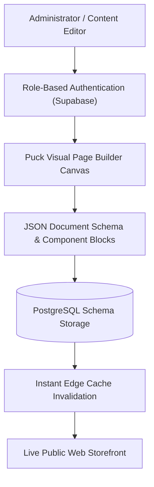

# Safar Studio — Visual In-Place Website CMS & Publishing Platform

[](https://safar-studio-snm.vercel.app)
[](https://vitejs.dev/)
[](https://puckeditor.com/)
[](https://supabase.com)
[](https://www.typescriptlang.org/)

**Safar Studio** is a full-featured visual content management system (CMS) and website publishing engine engineered for SAFAR N MANZIL and powered by Alif Growth Media. It empowers business owners and marketing teams to visually edit live web pages, announcements, service listings, and media without writing a single line of code.

---

## Architecture Flow



---

## Key Capabilities

- **In-Place Visual Editing:** Powered by `@puckeditor/core` and Drag-and-Drop Kit (`@dnd-kit`), owners can click any section, reorder blocks, and alter copy directly on their screen.
- **Supabase Cloud Sync:** Page schemas, published revisions, and media assets are stored safely with Row-Level Security (RLS) in PostgreSQL.
- **Role-Based Authentication:** Clean sign-in workflows separating public visitors from privileged site editors.
- **Instant Publishing:** Single-click publish to the live edge without requiring rebuilds or redeployments.
- **WhatsApp Webhook Integration:** Built-in webhook handlers connecting incoming website inquiries to automated WhatsApp notification pipelines.

---

## Tech Stack

- **Frontend:** React, Vite, TanStack Router, Tailwind CSS, Lucide Icons
- **Visual Builder:** `@puckeditor/core`, `@dnd-kit/core`, `@dnd-kit/sortable`
- **Backend & Storage:** Supabase (Auth, Postgres DB, Edge functions)
- **Deployment:** Vercel Edge Network

---

## Local Development Setup

### Prerequisites
- Node.js `18.x` or higher (or `bun`)
- npm or bun

### Step-by-Step Instructions
```bash
# 1. Clone the repository
git clone https://github.com/MuhammadMinhaj229/crm-invoicing-hub.git
cd crm-invoicing-hub

# 2. Install dependencies
npm install
# or if using bun:
# bun install

# 3. Configure environment variables
cp .env.example .env.local
```

Populate `.env.local` with your Supabase credentials:
```env
VITE_SUPABASE_URL=https://your-project.supabase.co
VITE_SUPABASE_ANON_KEY=your-anon-key
```

```bash
# 4. Start local development server
npm run dev
```
Open [http://localhost:5173](http://localhost:5173) in your browser.

---

## How to Deploy to Vercel

1. Push your repository to GitHub.
2. In the **[Vercel Dashboard](https://vercel.com/)**, click **Add New Project** and select `crm-invoicing-hub`.
3. Configure project settings:
   - **Framework Preset:** Vite
   - **Build Command:** `npm run build`
   - **Output Directory:** `dist`
4. Add Environment Variables:
   - `VITE_SUPABASE_URL` = `https://your-project.supabase.co`
   - `VITE_SUPABASE_ANON_KEY` = `your-anon-key`
5. Click **Deploy**. Your visual CMS will be live with instant global edge caching!

---

## Author & Support
Engineered by **Mohammed Minhaj Mahmood** for SAFAR N MANZIL & Alif Growth Media.  
For technical support or customization: [minhajmuhammad229@gmail.com](mailto:minhajmuhammad229@gmail.com).
